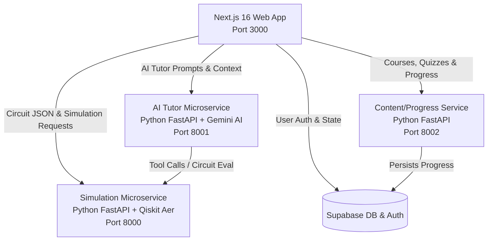

<div align="center">

# ⚛️ QMentor — Quantum Learning Platform

### *Democratizing Quantum Computing through Interactive Simulation, Visual Circuit Building & AI Tutoring*

[](https://nextjs.org/)
[](https://react.dev/)
[](https://www.python.org/)
[](https://fastapi.tiangolo.com/)
[](https://qiskit.org/)
[](https://ai.google.dev/)
[](https://threejs.org/)
[](https://supabase.com/)
[](LICENSE)

[Key Features](#-key-features) • [System Architecture](#-system-architecture) • [Quick Start](#-quick-start) • [Microservices](#-microservices) • [Supported Gates](#-supported-quantum-gates--algorithms) • [Monorepo Structure](#-monorepo-structure)

</div>

---

## 🌟 Overview

**QMentor** is an end-to-end interactive quantum computing learning platform designed to make quantum mechanics, quantum logic gates, and quantum algorithms intuitive and accessible. 

By unifying **drag-and-drop circuit design**, **interactive 3D Bloch sphere vector visualizations**, real-time **Qiskit Aer simulation**, and a context-aware **Google Gemini AI Tutor**, QMentor bridges the gap between abstract quantum mathematical theory $\left(|\psi\rangle = \alpha|0\rangle + \beta|1\rangle\right)$ and practical quantum software engineering.

```
       ┌─────────────────────────────────────────────────────────────┐
       │                   QMentor Web Application                   │
       │  ┌──────────────────────┐  ┌─────────────────────────────┐  │
       │  │ Visual Circuit Canvas│  │  3D Bloch Sphere & Math UI  │  │
       │  └──────────┬───────────┘  └──────────────┬──────────────┘  │
       └─────────────┼─────────────────────────────┼─────────────────┘
                     │                             │
       ┌─────────────▼─────────────────────────────▼─────────────────┐
       │                  Python Microservices Cluster               │
       │  ┌──────────────────┐  ┌──────────────────┐  ┌───────────┐  │
       │  │ Simulation API   │  │ AI Tutor Service │  │ Content/  │  │
       │  │  (Qiskit Aer)    │  │ (Gemini 2.0 AI)  │  │ Progress  │  │
       │  └──────────────────┘  └──────────────────┘  └───────────┘  │
       └─────────────────────────────────────────────────────────────┘
```

---

## ✨ Key Features

### 🎨 Visual Drag & Drop Quantum Circuit Builder
- Construct multi-qubit circuits with intuitive drag-and-drop mechanics.
- Support for Single-Qubit, Multi-Qubit Entangling, Parametric Rotation, and Measurement gates.
- Automatic Qiskit Python code generation synchronized in real-time with visual changes.

### 🌐 3D Interactive Bloch Sphere Visualization
- Render statevectors on an interactive 3D Bloch Sphere powered by **Three.js**.
- Visual representation of state rotation $(\theta, \phi)$ vectors, superpositions, and phase shifts.
- Real-time Dirac state vector inspector displaying complex amplitude coefficients $|\psi\rangle = \sum c_i |i\rangle$.

### ⚡ Qiskit Aer Simulation Engine
- High-performance FastAPI backend microservice running **IBM Qiskit 1.2** and **Qiskit Aer**.
- Calculates exact statevector amplitudes, phase angles, Dirac notations, and measurement probability distributions.
- Simulates quantum measurement sampling with configurable shot counts $(N=1024)$.

### 🤖 Gemini AI Quantum Tutor
- Integrated AI mentor powered by **Google Gemini AI**.
- Contextually aware of the student's active quantum circuit state, error messages, and lesson progress.
- Explains quantum principles (superposition, entanglement, interference, decoherence), suggests circuit optimizations, and debugs code.

### 💻 Integrated Monaco Code Editor
- Embedded VS Code-grade **Monaco Editor** with syntax highlighting for Python and Qiskit.
- Bi-directional workflow: build graphically or write Qiskit code directly.

### 📚 Gamified Learning & LaTeX Math Integration
- Comprehensive quantum mechanics curriculum spanning foundational concepts to advanced algorithms (Deutsch-Jozsa, Grover's, Shor's, Bell States).
- Beautiful LaTeX mathematical formula rendering with **KaTeX**.
- Progress tracking, quizzes, XP badges, and user dashboards backed by **Supabase**.

---

## 🏗️ System Architecture

QMentor is structured as a decoupled monorepo containing a modern Next.js frontend app and modular Python FastAPI microservices:



| Component | Technology Stack | Port | Description |
| :--- | :--- | :--- | :--- |
| **Web Frontend** | Next.js 16, React 19, TypeScript, Tailwind CSS, Three.js, Monaco | `3000` | User dashboard, interactive circuit builder, 3D Bloch sphere, learning platform |
| **Simulation API** | Python 3.11, FastAPI, Qiskit 1.2, Qiskit Aer, NumPy | `8000` | Executes circuits, computes statevectors, probabilities, and measurement histograms |
| **AI Tutor API** | Python 3.11, FastAPI, Google GenAI SDK (Gemini) | `8001` | Intelligent conversational quantum assistant and code debugger |
| **Content API** | Python 3.11, FastAPI, PyJWT, Supabase SDK | `8002` | Manages learning modules, quiz evaluation, XP streaks, and achievements |
| **Database & Auth** | Supabase (PostgreSQL, Row-Level Security) | Cloud | User authentication, state persistence, and progress records |

---

## 🚀 Quick Start

### 📋 Prerequisites

Ensure you have the following installed on your machine:
- **Node.js**: `v18.0.0` or higher ([Download](https://nodejs.org/))
- **Python**: `3.10` or `3.11` ([Download](https://www.python.org/))
- **Git**: Latest version

---

### ⚙️ Environment Setup

1. **Clone the Repository**
   ```bash
   git clone https://github.com/your-username/quantum-learning-platform.git
   cd quantum-learning-platform
   ```

2. **Configure AI Tutor Environment**
   Create a `.env` file in `services/ai-tutor/.env` (or copy from `.env.example`):
   ```env
   GEMINI_API_KEY=your_google_gemini_api_key_here
   ```

3. **Configure Web Frontend Environment**
   Create a `.env.local` file in `apps/web/.env.local`:
   ```env
   NEXT_PUBLIC_SUPABASE_URL=your_supabase_url
   NEXT_PUBLIC_SUPABASE_ANON_KEY=your_supabase_anon_key
   NEXT_PUBLIC_SIMULATION_API_URL=http://localhost:8000
   NEXT_PUBLIC_AI_TUTOR_API_URL=http://localhost:8001
   NEXT_PUBLIC_CONTENT_API_URL=http://localhost:8002
   ```

---

### 🏃 Launching QMentor

#### Option A: One-Click Startup (Windows)
Run the automated launcher script to set up virtual environments, install dependencies, and launch all 4 services:
```cmd
.\new_start.bat
```

#### Option B: Manual Setup (Linux / macOS / Windows Shell)

1. **Start Next.js Frontend**
   ```bash
   cd apps/web
   npm install
   npm run dev
   # Runs on http://localhost:3000
   ```

2. **Start Simulation Service**
   ```bash
   cd services/simulation
   python -m venv .venv
   source .venv/bin/activate  # On Windows: .venv\Scripts\activate
   pip install -r requirements.txt
   uvicorn main:app --reload --port 8000
   # API Docs at http://localhost:8000/docs
   ```

3. **Start AI Tutor Service**
   ```bash
   cd services/ai-tutor
   python -m venv .venv
   source .venv/bin/activate  # On Windows: .venv\Scripts\activate
   pip install -r requirements.txt
   uvicorn main:app --reload --port 8001
   # API Docs at http://localhost:8001/docs
   ```

4. **Start Content & Progress Service**
   ```bash
   cd services/content-progress
   python -m venv .venv
   source .venv/bin/activate  # On Windows: .venv\Scripts\activate
   pip install -r requirements.txt
   uvicorn main:app --reload --port 8002
   # API Docs at http://localhost:8002/docs
   ```

---

## 🎛️ Supported Quantum Gates & Algorithms

### Quantum Gate Palette

| Category | Gates | Matrix / Action |
| :--- | :--- | :--- |
| **Single-Qubit Hadamard** | `H` | Creates equal superposition: $\frac{1}{\sqrt{2}}\begin{pmatrix} 1 & 1 \\ 1 & -1 \end{pmatrix}$ |
| **Pauli Spin Gates** | `X`, `Y`, `Z` | Bit-flip (NOT), Bit & Phase-flip, Phase-flip |
| **Phase Rotation Gates** | `S`, `T` | $\pi/2$ and $\pi/4$ phase shift gates |
| **Parametric Rotations** | `RX(θ)`, `RY(θ)`, `RZ(θ)` | Continuous rotation around $X, Y, Z$ axes on the Bloch Sphere |
| **Controlled Multi-Qubit** | `CNOT (CX)`, `CZ` | Entangles target qubit based on control qubit state |
| **Swaps & Toffoli** | `SWAP`, `CCNOT` | Qubit state swap and 3-qubit controlled-controlled-NOT |
| **Measurement** | `M` | Collapses state vector into classical binary outcome $(0 \text{ or } 1)$ |

### Interactive Algorithm Templates
- **Bell States ($\Phi^+, \Phi^-, \Psi^+, \Psi^-$)**: Maximal 2-qubit quantum entanglement.
- **Quantum Teleportation**: Transmitting unknown quantum states using entanglement and classical communication.
- **Deutsch-Jozsa Algorithm**: Demonstrating exponential quantum speedup over classical algorithms.
- **Grover's Search Algorithm**: Unstructured database search with quadratic speedup $O(\sqrt{N})$.
- **Quantum Key Distribution (BB84)**: Quantum cryptography protocol ensuring unbreakable key exchange.

---

## 📁 Monorepo Structure

```
quantum-learning-platform/
├── apps/
│   └── web/                   # Next.js 16 Web Application
│       ├── app/               # Next.js App Router (pages: /builder, /learn, /dashboard, /editor)
│       ├── components/        # React components (circuit builder, Bloch sphere, AI chat)
│       ├── lib/               # Utility scripts & API client hooks
│       └── public/            # Static assets & icons
├── services/
│   ├── ai-tutor/              # FastAPI + Google Gemini AI tutoring service
│   ├── content-progress/      # FastAPI + Supabase learning progress & quiz service
│   └── simulation/            # FastAPI + Qiskit Aer quantum circuit simulator engine
├── supabase/                  # Supabase database migrations, seed data & SQL schemas
├── docs/                      # Platform design documentation & architecture specifications
├── new_start.bat              # One-click Windows startup script
└── README.md                  # Project documentation
```

---

## 🧪 Testing & Verification

Run backend unit tests for the simulation and AI microservices:

```bash
# Test Quantum Simulation Backend
cd services/simulation
pytest

# Test AI Tutor Service
cd services/ai-tutor
pytest
```

---

## 🛡️ License

Distributed under the **MIT License**. See `LICENSE` for more information.

---

<div align="center">
  <sub>Built with ❤️ by the QMentor Team for Quantum Computing Enthusiasts & Students Worldwide.</sub>
</div>
